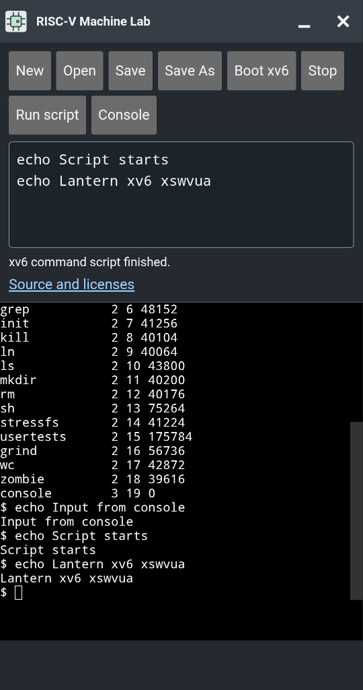
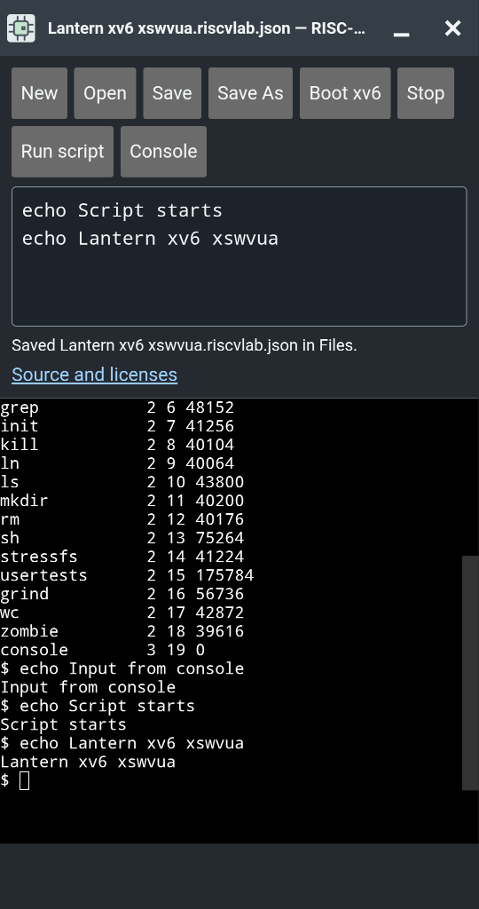

# RISC-V Machine Lab on the Galaxy S10+

Open **Programming → RISC-V Machine Lab**, then choose **Boot xv6**.
When the shell is ready, tap **Run script**. The starter script prints
`Hello from xv6` and lists files on the emulated disk. The shell prompt
returns after both commands.

Tap **Console** to type at the prompt. Enter `echo Hello from the phone`
and press Enter. xv6 prints the same text. On a narrow screen, Run script
and the other main commands have 44 CSS pixel touch targets.

## Save the editable project

1. Replace the script with two short commands, one per line. Confirm
   that Run script executes both.
2. Select **Save**, choose a folder in **My files**, and type a bare
   name. The app adds `.riscvlab.json`. **Save As** accepts the full
   project suffix so you can keep a separate copy.
3. Close RISC-V Machine Lab and reopen the project from **My files**.
   Boot xv6 again to run the restored script. Edit it and use **Save**
   to update the same file.

A cancelled picker or a different filename suffix leaves the command
text intact. The project stores the xv6 preset and editable script.
Each boot starts from the supplied xv6 disk. Guest project files use
temporary My files. Signed-in project files can be opened in a fresh
browser session.

## Verification and build

The physical Galaxy S10+ ran Chrome 158.0.8127.92. Desktop Chromium
158.0.8127.36 replayed the workflow at 820 and 1300 CSS pixels.
The phone and desktop checks cover four of seven workflow groups.
They booted and stopped xv6, used direct shell input, ran an edited
script and reopened an editable project. Native Linux boot, custom
kernel and disk loading, and native debugging have separate gaps
in the WebOS launcher.

The runtime build uses the checked xv6 kernel and disk, the retained
Wasm and its binding, and xterm.js 6.0.0. The rebuild of the previous
viewer matched its application JavaScript and CSS bytes. The revised
package changes only those two files. See the
[WebOS build guide](../../webos/README.md).

Runtime revision `9a52b700071c2b0f5bb7db99075dbfab1b79b9a7` is live in
viewer `f9c8cf22f5593ed315f4a0ab8ca8ea77c65ac1b324f3aa8d212519decc58cc87`.
All 27 changed paths matched over HTTPS. The hosted S10+ guest replay
ran the stock script and direct console input, saved a bare name and
reopened and edited the project. It also ran the revised script.
Both screenshots are from that replay. Command byte limits,
project parsing, and all 12 Files association checks passed.

[WebOS release and rollback](https://github.com/CC-David-CC/WebOS/blob/webos/riscv-phone-projects/deploy/ACTIVE-RELEASE.md#risc-v-machine-lab-phone-console-and-files)
